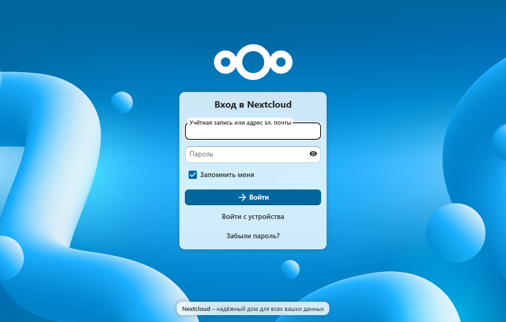
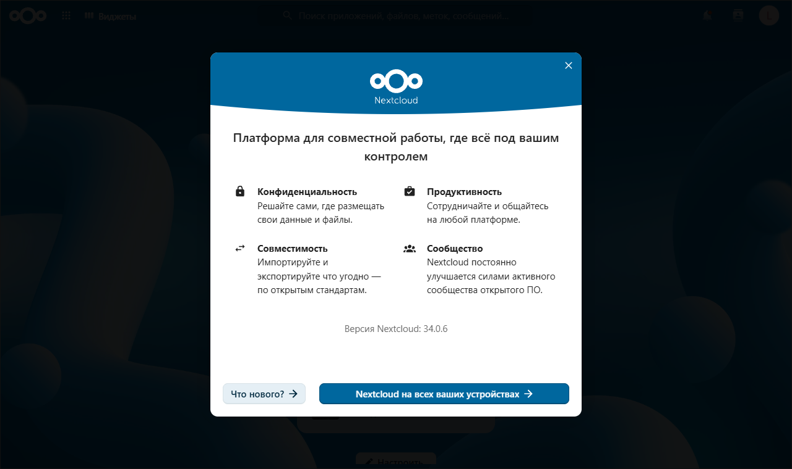

# ЛР 3. Kubernetes

Подняли minikube и развернули Nextcloud с PostgreSQL по манифестам из методички. По заданию перенесли логин и пароль Postgres из ConfigMap в Secret, переменные Nextcloud из Deployment в ConfigMap и добавили Nextcloud пробы. Манифесты лежат в [lab3-nextcloud/](../lab3-nextcloud).

## Окружение

minikube v1.39.0 с драйвером docker, Kubernetes v1.37.0, Docker Desktop 29.2.1 на Windows 11. Docker Hub из нашей сети недоступен, поэтому кластер запускали с зеркалом:

```bash
minikube start --driver=docker --cpus=4 --memory=4096 --registry-mirror=https://mirror.gcr.io
```

## Запуск

```bash
kubectl apply -f lab3-nextcloud/
kubectl expose deployment nextcloud --type=NodePort --port=80
minikube service nextcloud
```

`minikube service` открывает браузер и держит терминал, пока работает туннель. Установка Nextcloud занимает 2–3 минуты, после этого можно войти как `labadmin` с паролем из `nextcloud-secret` в [nextcloud.yml](../lab3-nextcloud/nextcloud.yml).

```
$ kubectl get deploy,pods,svc
NAME                        READY   UP-TO-DATE   AVAILABLE   AGE
deployment.apps/nextcloud   1/1     1            1           6m3s
deployment.apps/postgres    1/1     1            1           6m3s

NAME                             READY   STATUS    RESTARTS   AGE
pod/nextcloud-676d5cd899-wmc2d   1/1     Running   0          117s
pod/postgres-848ffcb678-9tq7d    1/1     Running   0          2m43s

NAME                       TYPE        CLUSTER-IP       EXTERNAL-IP   PORT(S)          AGE
service/nextcloud          NodePort    10.99.234.251    <none>        80:30725/TCP     152m
service/postgres-service   NodePort    10.110.116.208   <none>        5432:32029/TCP   155m
```

| Страница входа | После входа |
|---|---|
|  |  |

Необязательный шаг с dashboard: `minikube dashboard --url`. Его образы тоже скачались через зеркало.


## Пункты задания

| Пункт | Где сделано |
|---|---|
| Postgres: `POSTGRES_USER` и `POSTGRES_PASSWORD` в Secret | [pg_secret.yml](../lab3-nextcloud/pg_secret.yml), подключён в [pg_deployment.yml](../lab3-nextcloud/pg_deployment.yml) |
| Nextcloud: переменные из Deployment в ConfigMap | `nextcloud-configmap` в [nextcloud.yml](../lab3-nextcloud/nextcloud.yml) |
| Nextcloud: liveness и readiness | там же, плюс startup-проба |
| Манифесты, ход работы со скриншотами | этот отчёт |
| Ответы на вопросы | [Ответы на вопросы](#ответы-на-вопросы) |

## Что изменили в манифестах

| Файл | Изменение |
|---|---|
| [pg_secret.yml](../lab3-nextcloud/pg_secret.yml) | Новый Secret `postgres-secret` с `POSTGRES_USER` и `POSTGRES_PASSWORD` |
| [pg_configmap.yml](../lab3-nextcloud/pg_configmap.yml) | В ConfigMap осталась только `POSTGRES_DB` |
| [pg_deployment.yml](../lab3-nextcloud/pg_deployment.yml) | К `envFrom` добавлен `secretRef: postgres-secret` |
| [nextcloud.yml](../lab3-nextcloud/nextcloud.yml) | Новый ConfigMap `nextcloud-configmap` с пятью переменными. Deployment подключает его через `envFrom`, логин и пароль Postgres берёт из Secret. Добавлены пробы, лимит памяти поднят до 512Mi |

### Secret для Postgres

Postgres подключает ConfigMap и Secret целиком:

```yaml
envFrom:
  - configMapRef:
      name: postgres-configmap
  - secretRef:
      name: postgres-secret
```

Nextcloud берёт из чужих ConfigMap и Secret только нужные ключи: `configMapKeyRef` для имени базы, `secretKeyRef` для логина и пароля. По манифесту сразу видно, какие настройки Postgres нужны Nextcloud, и ничего лишнего в его окружение не попадает.

`kubectl describe` показывает у Secret только размер значений:

```
$ kubectl describe secret postgres-secret
Data
====
POSTGRES_PASSWORD:  16 bytes
POSTGRES_USER:      8 bytes
```

При этом значения не зашифрованы. `kubectl get secret postgres-secret -o yaml` выдаёт значения в base64, и `base64 -d` возвращает пароль. От ConfigMap Secret отличается тем, что доступ к нему можно ограничить отдельными правами RBAC и включить для него шифрование в etcd. Раз Secret сам ничего не шифрует, учебные пароли лежат в репозитории открытым текстом, в `stringData`. В рабочем проекте Secret создают из хранилища секретов, и файла с паролями в git нет.

### ConfigMap для Nextcloud

В `nextcloud-configmap` перенесли `NEXTCLOUD_UPDATE`, `ALLOW_EMPTY_PASSWORD`, `POSTGRES_HOST`, `NEXTCLOUD_TRUSTED_DOMAINS` и `NEXTCLOUD_ADMIN_USER`. Логин администратора секретом не считаем, его пароль остался в `nextcloud-secret`. В поде переменные те же, что и до переноса:

```
$ kubectl exec deploy/nextcloud -- env | grep -E 'POSTGRES_HOST|NEXTCLOUD_UPDATE|NEXTCLOUD_ADMIN_USER'
NEXTCLOUD_ADMIN_USER=labadmin
POSTGRES_HOST=postgres-service
NEXTCLOUD_UPDATE=1
```

Две переменные из методички на этот образ не влияют, но мы их оставили. `ALLOW_EMPTY_PASSWORD` скрипт запуска вообще не читает. `NEXTCLOUD_UPDATE=1` включает инициализацию, если контейнер запущен с командой, отличной от `apache`. У нас команда как раз `apache`, и инициализация включена без неё (`/entrypoint.sh`, строка 142).

### Пробы

| Проба | Что проверяет | Зачем так |
|---|---|---|
| startup | `GET /status.php`, раз в 10 с, до 60 неудач | Первая установка занимает 2–3 минуты. Пока startup-проба не прошла, две другие не запускаются и не убьют под посреди установки |
| readiness | `GET /status.php` | Отвечает ли Nextcloud целиком: PHP, конфиг и база. Если нет, Kubernetes перестаёт слать на под трафик, но сам под не трогает |
| liveness | `GET /robots.txt` | Жив ли Apache. Статический файл не зависит от PHP и базы, поэтому падение Postgres не вызовет бесполезных перезапусков Nextcloud |

Пробам на `/status.php` пришлось добавить заголовок `Host: 127.0.0.1`. Kubelet обращается по IP пода, а Nextcloud отвечает только доверенным доменам.

## Ответы на вопросы

### Важен ли порядок применения манифестов?

Для этих манифестов порядок влияет на ход запуска, но не на итог. Мы применили `nextcloud.yml` первым, когда объектов Postgres ещё не было:

```
$ kubectl apply -f nextcloud.yml
$ kubectl get pods
NAME                         READY   STATUS                       RESTARTS   AGE
nextcloud-75cc5d494c-8l9jk   0/1     CreateContainerConfigError   0          20s

$ kubectl describe pod -l app=nextcloud
  Warning  Failed  8s (x3 over 20s)  kubelet  Error: configmap "postgres-configmap" not found
```

Под создался, а контейнер в нём не стартовал: Deployment ссылается на ConfigMap, которого ещё нет. Kubelet повторял попытку каждые несколько секунд. Когда мы создали ConfigMap, Secret, Service и Deployment Postgres, контейнер запустился в том же поде `nextcloud-75cc5d494c-8l9jk`, под не пересоздавался. Kubernetes декларативен: контроллеры постоянно сверяют кластер с описанием и доводят его до нужного состояния, в каком бы порядке ни появлялись объекты.

Обычный `kubectl apply -f lab3-nextcloud/` тоже применяет файлы в неудобном порядке, по алфавиту: `nextcloud.yml` первым, `pg_deployment.yml` раньше `pg_secret.yml`. Работает это по той же причине.

Последствия у порядка всё же есть.

- Пока зависимостей нет, ничего не работает. В событиях пода копятся ошибки, сервис недоступен.
- Приложение может стартовать раньше базы. У нас Nextcloud и Postgres запустились одновременно, и установка прошла с первой попытки (строки `Retrying install...` в логе нет). Nextcloud около двух минут копировал файлы, и база за это время успела подняться. Не успей она, скрипт запуска образа повторил бы установку до 10 раз (`max_retries=10` в `/entrypoint.sh`). Если в образе такого повтора нет, нужен init-контейнер, который ждёт базу. Так сделано в ЛР 4.
- Kubernetes передаёт в под переменные вида `POSTGRES_SERVICE_SERVICE_HOST` только для тех Service, что существовали при создании пода. Манифесты обращаются к базе по DNS-имени `postgres-service`, которое работает всегда, поэтому нас это не задело.
- Иногда порядок обязателен. Например, объект нельзя создать в пространстве имён, которого ещё нет. `apply` вернёт ошибку и сам повторять не будет. Поэтому в ЛР 4 файл с Namespace идёт первым.

Удобнее всего применять так: Namespace, ConfigMap и Secret, Service, Deployment.

### Что будет, если уменьшить число реплик Postgres до 0, потом вернуть 1 и зайти в Nextcloud?

Nextcloud сломается и сам не восстановится. Мы это проверили: после каждого шага выжидали около 5 секунд и запрашивали `GET /login` через туннель `minikube service`, то есть через Service.

| Момент | Таблиц Nextcloud в базе | `GET /login` |
|---|---|---|
| До | 131 | 200 |
| `replicas=0` | — (база недоступна) | 500 |
| Снова `replicas=1` | 0 | нет ответа |

Что произошло:

1. У Postgres нет тома. Данные лежали в файловой системе контейнера и пропали вместе с подом. Новый под инициализировал пустой кластер с логином и паролем из Secret.
2. Nextcloud об этом не знает. В его `config.php` записано `'installed' => true`, и установку он не повторяет. К базе он подключается пользователем `oc_admin`, созданным при установке, а в новой базе такого пользователя нет:
   ```
   FATAL: password authentication failed for user "oc_admin"
   ```
3. Под выведен из Service, но не перезапущен. Readiness на `/status.php` получает 500, поэтому endpoints у Service `nextcloud` пустеют, и браузер через туннель ответа не дожидается. Liveness на `/robots.txt` проходит, и kubelet под не трогает. Да и перезапуск не вернул бы данные.

Починили командой `kubectl rollout restart deployment nextcloud`. Тома нет и у Nextcloud, так что новый контейнер начал без `config.php` и установился заново. Все пользовательские данные при этом потеряны.

Чтобы такого не случилось, базе нужен PersistentVolumeClaim, смонтированный в `/var/lib/postgresql/data`. В ЛР 4 он у базы есть.

## Что пошло не по методичке

Nextcloud не хватило лимита 256Mi из методички. Установку под прошёл, а при первом входе через браузер упал: `lastState.terminated.reason: OOMKilled`, код 137. Интерфейс шлёт много запросов сразу, и Apache запускает под них несколько PHP-процессов. С лимитом 512Mi (request 256Mi) тот же вход прошёл. `memory.peak` при этом дошёл до лимита, но туда входит файловый кэш, который ядро вытесняет при нехватке памяти. Самим процессам (`anon` в `memory.stat`) после входа нужно около 121 МиБ, кэш занимает около 246 МиБ, а `oom_kill` в `memory.events` остался нулевым.

Без тома Nextcloud заново устанавливается в каждом новом контейнере. Когда мы меняли лимит, rolling update запустил новый под, пока старый ещё работал. Новый попытался установить Nextcloud в базу, где тот уже стоял, и упал с `Installing of nextcloud failed!`. Пришлось удалить оба Deployment и применить манифесты заново. После OOMKilled контейнер тоже начинал установку с нуля. По-хорошему Nextcloud нужен том для `/var/www/html`: новый под найдёт там готовый `config.php`.

В методичке `postgres-service` типа NodePort, то есть база открыта на порту узла. Nextcloud ходит к ней изнутри кластера, и хватило бы ClusterIP. Менять не стали, задание этого не касалось.
