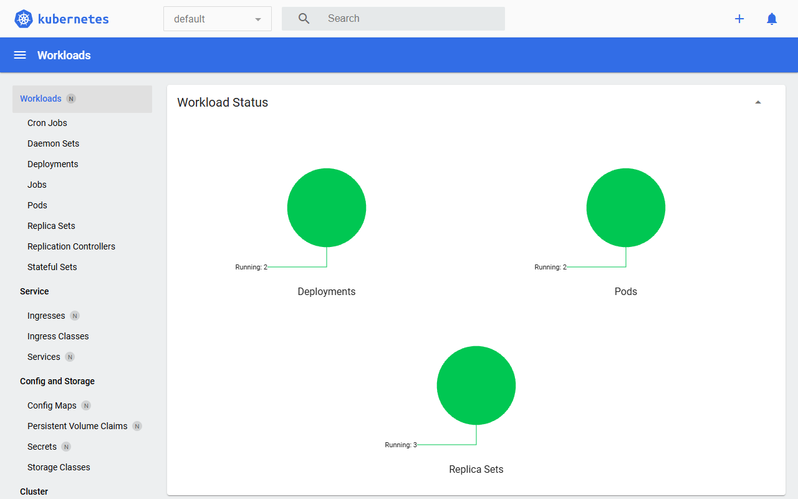

# ЛР 3. Kubernetes

Подняли minikube, развернули Nextcloud с PostgreSQL по манифестам из методички и доработали их по заданию:

- логин и пароль Postgres перенесли из ConfigMap в Secret;
- переменные Nextcloud перенесли из Deployment в ConfigMap;
- добавили Nextcloud пробы.

Манифесты лежат в [lab3-nextcloud/](../lab3-nextcloud).

## Окружение

minikube v1.39.0 с драйвером docker, Kubernetes v1.37.0, Docker Desktop 29.2.1 на Windows 11. Docker Hub из нашей сети недоступен, поэтому кластер запускали с зеркалом:

```bash
minikube start --driver=docker --cpus=4 --memory=4096 --registry-mirror=https://mirror.gcr.io
```

## Запуск

```bash
kubectl apply -f lab3-nextcloud/
kubectl expose deployment nextcloud --type=NodePort --port=80
minikube service nextcloud
```

Через 2–3 минуты Nextcloud заканчивает установку, и вход работает с логином `labadmin` и паролем из `nextcloud-secret` в [nextcloud.yml](../lab3-nextcloud/nextcloud.yml).

```
$ kubectl get deploy,pods,svc
NAME                        READY   UP-TO-DATE   AVAILABLE
deployment.apps/nextcloud   1/1     1            1
deployment.apps/postgres    1/1     1            1

NAME                             READY   STATUS    RESTARTS
pod/nextcloud-676d5cd899-wmc2d   1/1     Running   0
pod/postgres-848ffcb678-9tq7d    1/1     Running   0

NAME                       TYPE        CLUSTER-IP       PORT(S)
service/nextcloud          NodePort    10.99.234.251    80:30725/TCP
service/postgres-service   NodePort    10.110.116.208   5432:32029/TCP
```

| Страница входа | После входа |
|---|---|
|  |  |

Необязательный шаг с dashboard: `minikube dashboard --url` (образы дополнения тоже пришли через зеркало).



## Что изменили в манифестах

| Файл | Изменение |
|---|---|
| [pg_secret.yml](../lab3-nextcloud/pg_secret.yml) | Новый Secret `postgres-secret` с `POSTGRES_USER` и `POSTGRES_PASSWORD` |
| [pg_configmap.yml](../lab3-nextcloud/pg_configmap.yml) | В ConfigMap осталась только `POSTGRES_DB` |
| [pg_deployment.yml](../lab3-nextcloud/pg_deployment.yml) | К `envFrom` добавлен `secretRef: postgres-secret` |
| [nextcloud.yml](../lab3-nextcloud/nextcloud.yml) | Новый ConfigMap `nextcloud-configmap` с пятью переменными. Deployment подключает его через `envFrom`, логин и пароль Postgres берёт из Secret. Добавлены пробы, лимит памяти поднят до 512Mi |

### Secret для Postgres

Postgres получает обе части окружения целиком:

```yaml
envFrom:
  - configMapRef:
      name: postgres-configmap
  - secretRef:
      name: postgres-secret
```

Nextcloud нужны те же значения, но под другими ролями, поэтому он берёт их по одному ключу: `configMapKeyRef` для имени базы, `secretKeyRef` для логина и пароля.

`kubectl describe` показывает у Secret только размер значений:

```
$ kubectl describe secret postgres-secret
Data
====
POSTGRES_PASSWORD:  16 bytes
POSTGRES_USER:      8 bytes
```

Но это не шифрование. `kubectl get secret postgres-secret -o yaml` выдаёт значения в base64, а `base64 -d` возвращает пароль. Secret отделяет секреты от обычных настроек: доступ к ним можно закрыть отдельными правами RBAC и включить шифрование хранилища etcd. Сам по себе он пароль не прячет.

### ConfigMap для Nextcloud

В `nextcloud-configmap` ушли `NEXTCLOUD_UPDATE`, `ALLOW_EMPTY_PASSWORD`, `POSTGRES_HOST`, `NEXTCLOUD_TRUSTED_DOMAINS` и `NEXTCLOUD_ADMIN_USER`. Логин администратора — не секрет, а пароль остался в `nextcloud-secret`. Внутри пода переменные те же, что раньше:

```
$ kubectl exec deploy/nextcloud -- env | grep -E 'POSTGRES_HOST|NEXTCLOUD_UPDATE|NEXTCLOUD_ADMIN_USER'
NEXTCLOUD_ADMIN_USER=labadmin
POSTGRES_HOST=postgres-service
NEXTCLOUD_UPDATE=1
```

### Пробы

| Проба | Что проверяет | Почему так |
|---|---|---|
| startup | `GET /status.php`, раз в 10 с, до 60 неудач | Первая установка занимает 2–3 минуты. Пока startup-проба не прошла, две другие не запускаются и не убьют под посреди установки |
| readiness | `GET /status.php` | Nextcloud целиком: PHP, конфиг и база. Если не отвечает, Kubernetes перестаёт слать трафик, но под не трогает |
| liveness | `GET /robots.txt` | Жив ли Apache. Статический файл не зависит от PHP и базы, поэтому падение Postgres не вызовет бесполезных перезапусков Nextcloud |

У проб на `/status.php` есть заголовок `Host: 127.0.0.1`. Nextcloud отвечает только доверенным доменам, а kubelet обращается по IP пода.

## Ответы на вопросы

### Важен ли порядок применения манифестов?

Для конечного результата не важен, а для того, как пройдёт запуск, важен. Мы проверили это на практике и первым применили `nextcloud.yml`, когда объектов Postgres ещё не было:

```
$ kubectl apply -f nextcloud.yml
$ kubectl get pods
nextcloud-75cc5d494c-8l9jk   0/1   CreateContainerConfigError   0   20s

Warning  Failed  kubelet  Error: configmap "postgres-configmap" not found
```

Под создался, но контейнер не стартовал: Deployment ссылается на ConfigMap, которого нет. Kubelet повторял попытку каждые несколько секунд. Как только мы создали ConfigMap, Secret, Service и Deployment Postgres, тот же самый под запустился сам, без пересоздания (`RESTARTS 0`). Kubernetes работает декларативно: контроллеры доводят кластер до описанного состояния, в каком бы порядке ни появлялись объекты.

Но последствия у порядка есть:

- **Пока зависимостей нет, ничего не работает.** В событиях пода копятся ошибки, а сервис недоступен.
- **Приложение может стартовать раньше базы.** У нас Nextcloud и Postgres запустились одновременно. Nextcloud не упал только потому, что скрипт запуска образа повторяет установку до 10 раз (`max_retries=10` в `/entrypoint.sh`), а копирование файлов заняло больше времени, чем инициализация базы. Без такого повтора нужен init-контейнер, который ждёт базу. Так мы и сделали в ЛР 4.
- **Переменные окружения сервисов.** Kubernetes передаёт в под переменные вида `POSTGRES_SERVICE_SERVICE_HOST` только для тех Service, что существовали при создании пода. DNS-имя `postgres-service` работает всегда, и манифесты используют именно его, так что нас это не затронуло.

Поэтому удобный порядок такой: ConfigMap и Secret, затем Service, затем Deployment. `kubectl apply -f каталог/` применяет файлы по алфавиту, и на итог это не влияет.

### Что будет, если уменьшить число реплик Postgres до 0, потом вернуть 1 и зайти в Nextcloud?

Nextcloud сломается и сам не восстановится. Мы проверили это экспериментом:

| Момент | Таблиц Nextcloud в базе | `GET /login` |
|---|---|---|
| До | 131 | 200 |
| `replicas=0` | — (база недоступна) | 500 |
| Снова `replicas=1` | 0 | нет ответа |

Почему так:

1. **У Postgres нет тома.** Данные лежали в файловой системе контейнера и пропали вместе с подом. Новый под инициализировал пустой кластер с логином и паролем из Secret.
2. **Nextcloud об этом не знает.** В его `config.php` записано `'installed' => true`, поэтому установку он не повторяет. При установке Nextcloud создал в базе своего пользователя `oc_admin`, а теперь этого пользователя нет:
   ```
   FATAL: password authentication failed for user "oc_admin"
   ```
3. **Пробы делают то, для чего их настроили.** Readiness на `/status.php` получает 500, и под исключается из Service: endpoints у `nextcloud` пустые, браузер через `minikube service` не получает ответа. Liveness на `/robots.txt` проходит, поэтому под не перезапускается. Перезапуск и не помог бы вернуть данные.

Мы вернули Nextcloud в строй командой `kubectl rollout restart deployment nextcloud`. У нового контейнера нет `config.php`, потому что у Nextcloud тоже нет тома, и он установился заново. Все пользовательские данные при этом потеряны.

Вывод: базе нужно постоянное хранилище, то есть PersistentVolumeClaim, смонтированный в `/var/lib/postgresql/data`. Для баз обычно берут StatefulSet. В ЛР 4 у нашей базы такой том есть.

## Что заметили по ходу

- **256Mi памяти Nextcloud не хватает.** С лимитом из методички под проходил установку, но при первом входе через браузер падал с `OOMKilled` (код 137): интерфейс шлёт много запросов сразу, и Apache запускает несколько PHP-процессов. Мы подняли лимит до 512Mi (request 256Mi) и повторили тот же вход: `oom_kill = 0`. В покое процессам нужно около 121 МиБ, ещё около 246 МиБ занимает файловый кэш, который ядро при нехватке памяти вытесняет.
- **Без тома любой перезапуск Nextcloud — это новая установка.** Когда мы меняли лимит, rolling update запустил новый под, пока старый ещё работал. Новый попытался установить Nextcloud в базу, где он уже стоял, и упал с `Installing of nextcloud failed!`. После OOMKilled контейнер тоже начинал установку заново. В рабочей конфигурации у Nextcloud должен быть том для `/var/www/html`, и тогда новый под увидит существующий `config.php`.
- **`postgres-service` типа NodePort** открывает базу на порту узла. Nextcloud ходит к ней внутри кластера, так что хватило бы ClusterIP. Мы оставили как в методичке, потому что задание этого не касалось.
