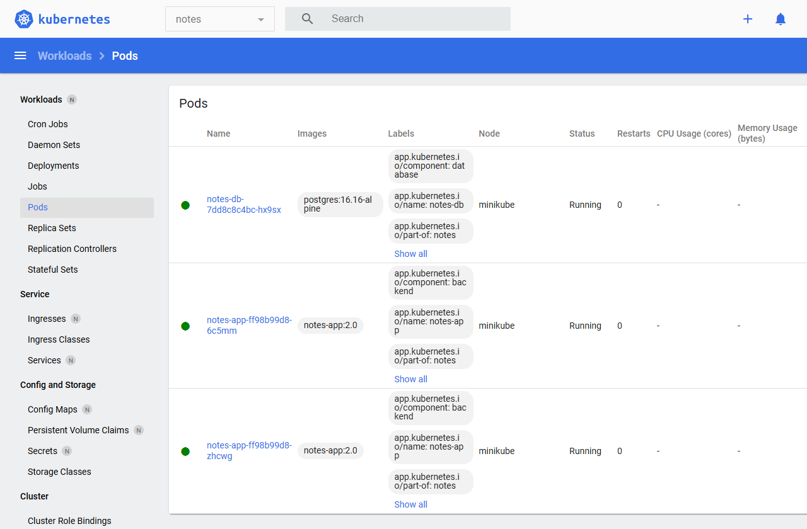

# ЛР 4. Своё приложение в Kubernetes

Связку из ЛР 2 перенесли в minikube: PostgreSQL с постоянным томом и две реплики «Заметок», вместо сервиса `migrate` init-контейнер. Манифесты лежат в [k8s/](../k8s), все объекты в пространстве имён `notes`.

## Запуск

```bash
docker build -t notes-app:2.0 .
minikube image load notes-app:2.0
minikube image load postgres:16.16-alpine
kubectl apply -f k8s/
minikube service notes-app -n notes --url
```

Образ приложения нигде не опубликован, поэтому загружаем его в minikube напрямую. Файлы пронумерованы, потому что `apply` идёт по алфавиту, а Namespace нужен первым. Удалить всё: `kubectl delete namespace notes`.


Поды в dashboard (`minikube dashboard`), с метками и без перезапусков:



```
                 Service notes-app (NodePort)
                    │               │
          ┌─────────┴───┐       ┌───┴─────────┐
          │ pod app #1  │       │ pod app #2  │   Deployment notes-app
          │ init:migrate│       │ init:migrate│
          │ app: serve  │       │ app: serve  │
          └──────┬──────┘       └──────┬──────┘
                 └──────┬──────────────┘
               Service notes-db (ClusterIP)
                        │
                 ┌──────┴──────┐
                 │ pod postgres│──── PVC notes-db-data (1Gi)
                 └─────────────┘     Deployment notes-db
```

## Пункты задания

| Пункт | Где сделано |
|---|---|
| Минимум два Deployment | `notes-db` и `notes-app` |
| Кастомный образ хотя бы для одного | `notes-app:2.0` из нашего Dockerfile |
| Контейнер и init-контейнер в одном Deployment | `notes-app`: init `migrate` и основной `app` |
| Volume | PVC `notes-db-data` в `/var/lib/postgresql/data` |
| ConfigMap и/или Secret | У базы `notes-db-config` и `notes-db-secret`, у приложения `notes-app-config` и `notes-app-secret` |
| Service | `notes-db` (ClusterIP) и `notes-app` (NodePort) |
| Liveness / Readiness | у приложения обе, у базы `pg_isready` и TCP-проверка |
| Метки сверх selector | `part-of`, `component`, `version` |

Оба Deployment подключают переменные через `envFrom` только из собственных ConfigMap и Secret. Приложение использует имена `DB_NAME`, `DB_USER`, `DB_PASSWORD`, а образ PostgreSQL — `POSTGRES_DB`, `POSTGRES_USER`, `POSTGRES_PASSWORD`. Для пробы `pg_isready` в конфигурации базы заданы `PGDATABASE` и `PGUSER`, поэтому в Deployment не перечислены даже имена переменных для проверки. В init-контейнере и сервере один набор настроек приложения. Значения имени базы и учётных данных в двух наборах ресурсов должны совпадать.

## Ход работы

### Init-контейнер

Init-контейнер запускает тот же образ с командой `migrate`. Он ждёт базу, создаёт схему и завершается, и только после этого стартует приложение:

```
$ kubectl -n notes logs notes-app-ff98b99d8-6c5mm -c migrate
2026-11-20T23:57:04.602955941Z waiting for database: Connection to notes-db:5432 refused. …
…
2026-11-20T23:57:11.208359864Z connected to jdbc:postgresql://notes-db:5432/notes
2026-11-20T23:57:11.349433024Z migration done
```

`MIGRATE_TIMEOUT` в `notes-app-config` увеличен до 180 секунд, потому что первая инициализация базы у нас шла до двух минут. Две реплики запускают миграцию одновременно, и мешать друг другу им не даёт блокировка `pg_advisory_xact_lock`.

### Данные переживают удаление пода базы

```
$ kubectl -n notes delete pod -l app.kubernetes.io/name=notes-db
$ curl http://127.0.0.1:52512/api/notes
[{"id":2,"text":"Заметка из Kubernetes",...},{"id":1,"text":"Схему создала команда migrate",...}]
```

Новый под подключил тот же PVC. `PGDATA` задан в `notes-db-config` и указывает на подкаталог тома, чтобы служебный `lost+found` не мешал инициализации. `strategy: Recreate` не даёт двум Postgres одновременно писать в один том при обновлении. Реплика базы одна, поэтому StatefulSet не понадобился.

### Пробы

Пока база перезапускалась, readiness (`/health/ready`) получала 503 и поды выпадали из Service. Liveness (`/health/live`) проходила, поэтому перезапусков не было:

```
$ kubectl -n notes get events          # вывод сокращён
Warning  Unhealthy  pod/notes-app-ff98b99d8-zhcwg  Readiness probe failed: HTTP probe failed with statuscode: 503

$ kubectl -n notes get pods -l app.kubernetes.io/name=notes-app
NAME                        READY   STATUS    RESTARTS   AGE
notes-app-ff98b99d8-6c5mm   1/1     Running   0          50s
notes-app-ff98b99d8-zhcwg   1/1     Running   0          50s
```

### Две реплики

Страница показывает имя пода, который ответил. Из 10 запросов один под обработал 2, другой 8.

### Метки

Используем рекомендованные метки `app.kubernetes.io/*`: `name`, `component`, `part-of`, на обоих Deployment и подах приложения ещё `version`. По ним выбираются объекты одной роли:

```
$ kubectl -n notes get all -l app.kubernetes.io/component=database -o name
pod/notes-db-7dd8c8c4bc-c4hpn
service/notes-db
deployment.apps/notes-db
replicaset.apps/notes-db-7dd8c8c4bc
```

В selector входит только `name`. Selector Deployment менять нельзя, и с `version` в нём каждое обновление требовало бы пересоздавать Deployment.

### Запуск не от root

В поде приложения указано `runAsNonRoot: true`. Наш образ работает под uid 10001 и проверку проходит, а `postgres:16.16-alpine`, который стартует от root, с той же настройкой не запускается:

```
$ kubectl -n notes run rootcheck --image=postgres:16.16-alpine --restart=Never \
    --overrides='{"spec":{"securityContext":{"runAsNonRoot":true}}}'
$ kubectl -n notes get pod rootcheck \
    -o jsonpath='{.status.containerStatuses[0].state.waiting.reason}: {.status.containerStatuses[0].state.waiting.message}'
CreateContainerConfigError: container has runAsNonRoot and image will run as root (pod: "rootcheck_notes(…)", container: rootcheck)
```
