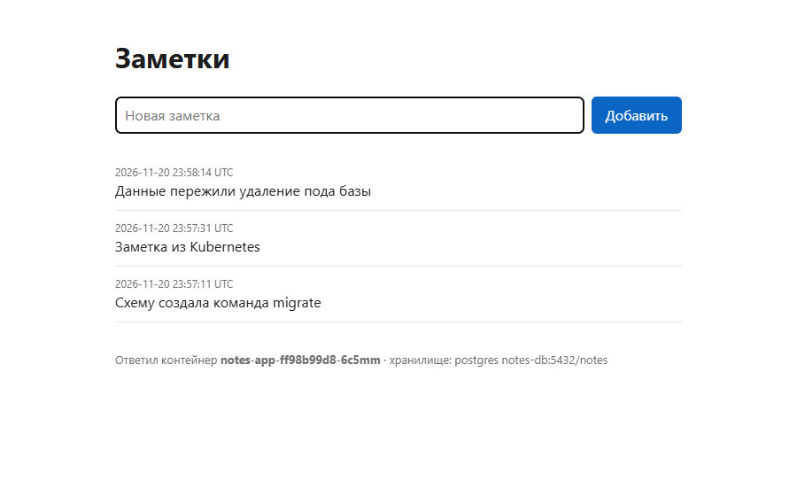

# ЛР 4. Своё приложение в Kubernetes

Связку из ЛР 2 перенесли в minikube: PostgreSQL и две реплики «Заметок». Вместо сервиса `migrate` теперь init-контейнер. Манифесты лежат в [k8s/](../k8s), все объекты создаются в пространстве имён `notes`.

## Запуск

Образ приложения нигде не опубликован, поэтому собираем его из [Dockerfile](../Dockerfile) и загружаем в minikube напрямую. Образ Postgres загружаем так же, чтобы не зависеть от Docker Hub.

```bash
docker build -t notes-app:2.0 .
minikube image load notes-app:2.0
minikube image load postgres:16.16-alpine

kubectl apply -f k8s/
kubectl -n notes rollout status deploy/notes-app
minikube service notes-app -n notes --url
```

Последняя команда открывает туннель и печатает адрес вроде `http://127.0.0.1:52512`. Порт каждый раз новый, терминал с туннелем закрывать нельзя. В примерах ниже адрес из нашего запуска.

Номера в именах файлов нужны потому, что `kubectl apply -f k8s/` идёт по алфавиту, а Namespace должен появиться первым. Удаляется всё одной командой: `kubectl delete namespace notes`.

```
$ kubectl -n notes get deploy,pods,svc,pvc
NAME                        READY   UP-TO-DATE   AVAILABLE   AGE
deployment.apps/notes-app   2/2     2            2           80s
deployment.apps/notes-db    1/1     1            1           81s

NAME                            READY   STATUS    RESTARTS   AGE
pod/notes-app-ff98b99d8-6c5mm   1/1     Running   0          80s
pod/notes-app-ff98b99d8-zhcwg   1/1     Running   0          80s
pod/notes-db-7dd8c8c4bc-hx9sx   1/1     Running   0          47s

NAME                TYPE        CLUSTER-IP       EXTERNAL-IP   PORT(S)        AGE
service/notes-app   NodePort    10.108.100.217   <none>        80:30681/TCP   80s
service/notes-db    ClusterIP   10.98.71.91      <none>        5432/TCP       81s

NAME                                  STATUS   VOLUME                                     CAPACITY   ACCESS MODES   STORAGECLASS
persistentvolumeclaim/notes-db-data   Bound    pvc-4282984a-27f0-4140-9c3f-41ee9655bdf7   1Gi        RWO            standard
```



## Как устроено

```
                 Service notes-app (NodePort)
                    │               │
          ┌─────────┴───┐       ┌───┴─────────┐
          │ pod app #1  │       │ pod app #2  │   Deployment notes-app
          │ init:migrate│       │ init:migrate│
          │ app: serve  │       │ app: serve  │
          └──────┬──────┘       └──────┬──────┘
                 └──────┬──────────────┘
               Service notes-db (ClusterIP)
                        │
                 ┌──────┴──────┐
                 │ pod postgres│──── PVC notes-db-data (1Gi)
                 └─────────────┘     Deployment notes-db
```

| Файл | Что внутри |
|---|---|
| [00-namespace.yml](../k8s/00-namespace.yml) | пространство имён `notes` |
| [10-config.yml](../k8s/10-config.yml) | ConfigMap `notes-config` (имя базы, хост, режим хранилища) и Secret `notes-db-secret` (логин и пароль) |
| [20-db.yml](../k8s/20-db.yml) | PVC, Deployment и Service базы |
| [30-app.yml](../k8s/30-app.yml) | Deployment приложения с init-контейнером и Service |

## Пункты задания

| Пункт | Где сделано |
|---|---|
| Минимум два Deployment | `notes-db` и `notes-app` |
| Кастомный образ хотя бы для одного | `notes-app:2.0`, собран из нашего Dockerfile и загружен в minikube через `minikube image load` |
| Контейнер и init-контейнер в одном Deployment | `notes-app`: init `migrate` и основной `app` |
| Volume | PVC `notes-db-data` смонтирован в `/var/lib/postgresql/data` |
| ConfigMap и/или Secret | оба: `notes-config` и `notes-db-secret` |
| Service | `notes-db` (ClusterIP) и `notes-app` (NodePort) |
| Liveness / Readiness | у приложения обе, у базы `pg_isready` и TCP-проверка |
| Метки сверх selector | `part-of` на всех объектах, `component` на объектах базы и приложения, `version` на Deployment и подах |

## Ход работы

### Init-контейнер ждёт базу и создаёт схему

`depends_on` в Kubernetes нет, и поды приложения стартуют вместе с базой. Init-контейнер `migrate` — тот же образ, запущенный с командой `migrate`. Он пытается подключиться, пока база не ответит, потом создаёт схему и завершается. Основной контейнер стартует, только если init-контейнер завершился успешно.

```
$ kubectl -n notes logs notes-app-ff98b99d8-6c5mm -c migrate
2026-11-20T23:57:04.602955941Z waiting for database: Connection to notes-db:5432 refused. …
2026-11-20T23:57:06.608019819Z waiting for database: Connection to notes-db:5432 refused. …
2026-11-20T23:57:08.608958640Z waiting for database: Connection to notes-db:5432 refused. …
2026-11-20T23:57:11.208359864Z connected to jdbc:postgresql://notes-db:5432/notes
2026-11-20T23:57:11.349433024Z migration done
```

`MIGRATE_TIMEOUT` в ConfigMap поставили 180 секунд вместо 60 в Compose. Первая инициализация базы на новом томе у нас доходила до двух минут (см. ЛР 2), и init-контейнер не должен сдаться раньше.

Реплик две, и миграция запускалась дважды почти одновременно. Друг другу запуски не мешают: перед изменением схемы команда берёт блокировку `pg_advisory_xact_lock`, а SQL-скрипт рассчитан на повторное выполнение. После обоих запусков в базе одна таблица и одна стартовая заметка.

### Данные переживают удаление пода базы

Удалили под Postgres. Deployment создал новый, тот подключил тот же PVC, и заметки остались на месте:

```
$ kubectl -n notes delete pod -l app.kubernetes.io/name=notes-db
$ curl http://127.0.0.1:52512/api/notes
[{"id":2,"text":"Заметка из Kubernetes",...},{"id":1,"text":"Схему создала команда migrate",...}]
```

В ЛР 3 после похожего опыта с Postgres без тома от 131 таблицы Nextcloud не осталось ни одной.

У Deployment базы `strategy: Recreate`. При обновлении старый под останавливается раньше, чем стартует новый, и два Postgres не пишут в один том одновременно. `PGDATA` указывает на подкаталог `pgdata`: в корне тома может оказаться служебный `lost+found`, и initdb откажется работать в непустом каталоге.

Для баз часто советуют StatefulSet, но мы взяли Deployment. StatefulSet нужен, когда у каждой реплики свой том и постоянное имя, например при репликации. У нас реплика одна, и Deployment с PVC и `Recreate` справляется.

### Пробы

Пока база перезапускалась, приложение отвечало на `/health/ready` кодом 503, readiness-проба не проходила, и Kubernetes на это время убрал поды из Service. Liveness проходила, поэтому поды не перезапускались. Когда база поднялась, оба пода снова стали готовы, перезапусков ноль:

```
$ kubectl -n notes get events          # вывод сокращён
Warning  Unhealthy  pod/notes-app-ff98b99d8-zhcwg  Readiness probe failed: HTTP probe failed with statuscode: 503
Warning  Unhealthy  pod/notes-app-ff98b99d8-6c5mm  Readiness probe failed: HTTP probe failed with statuscode: 503

$ kubectl -n notes get pods -l app.kubernetes.io/name=notes-app
NAME                        READY   STATUS    RESTARTS   AGE
notes-app-ff98b99d8-6c5mm   1/1     Running   0          50s
notes-app-ff98b99d8-zhcwg   1/1     Running   0          50s
```

Ради этого пробы и разведены по разным адресам. `/health/live` проверяет только процесс, `/health/ready` ещё и доступ к базе. Если бы liveness зависела от базы, каждый сбой Postgres перезапускал бы исправное приложение.

### Две реплики за одним Service

Страница показывает имя пода, который её отдал. Из 10 запросов подряд один под обработал 2, другой 8. Service раздаёт новые соединения готовым подам, но не строго по очереди.

### Метки

Взяли рекомендованные метки из документации Kubernetes, те же, что ставят Helm-чарты. На Deployment, подах, Service и PVC стоят `app.kubernetes.io/name`, `component` (database или backend) и `part-of: notes`, на Deployment и подах ещё `version`. На Namespace, ConfigMap и Secret только `part-of`. С метками объекты можно выбирать по роли, не перечисляя имена:

```
$ kubectl -n notes get all -l app.kubernetes.io/component=database -o name
pod/notes-db-7dd8c8c4bc-c4hpn
service/notes-db
deployment.apps/notes-db
replicaset.apps/notes-db-7dd8c8c4bc

$ kubectl -n notes get deploy,svc,pvc,cm,secret -l app.kubernetes.io/part-of=notes
```

Selector у Deployment и Service — одна метка `app.kubernetes.io/name`. Selector Deployment после создания менять нельзя, и если бы в него входила `version`, при каждой смене версии Deployment пришлось бы пересоздавать.

### Запуск не от root

В шаблоне пода приложения указано `securityContext.runAsNonRoot: true`. Наш образ из ЛР 1 работает под uid 10001 и проверку проходит:

```
$ kubectl -n notes exec deploy/notes-app -- id
uid=10001(app) gid=10001(app) groups=10001(app)
```

Для сравнения запустили с той же настройкой образ `postgres:16.16-alpine`, который стартует от root:

```
$ kubectl -n notes run rootcheck --image=postgres:16.16-alpine --restart=Never \
    --overrides='{"spec":{"securityContext":{"runAsNonRoot":true}}}'
$ kubectl -n notes get pod rootcheck \
    -o jsonpath='{.status.containerStatuses[0].state.waiting.reason}: {.status.containerStatuses[0].state.waiting.message}'
CreateContainerConfigError: container has runAsNonRoot and image will run as root (pod: "rootcheck_notes(…)", container: rootcheck)
```
